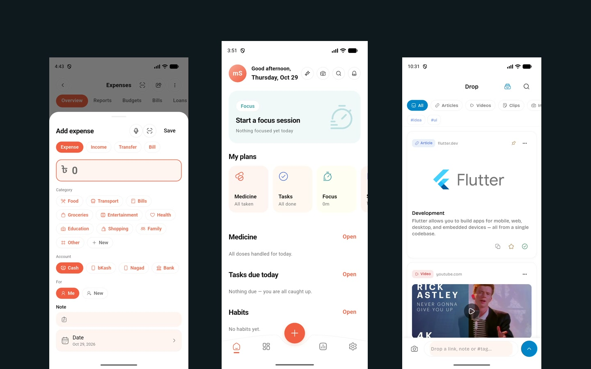
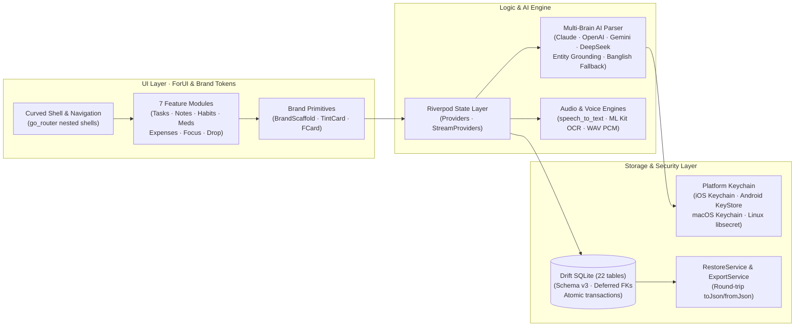
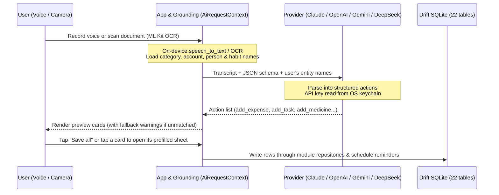

# Case study: LogSuite

**Seven Offline-First Productivity Modules on One SQLite Database**

Between June and November 2026, I built [LogSuite](https://github.com/aminurislamarnob/logsuite), an offline-first Flutter app that combines tasks, notes, habits, medicine schedules, expenses, a focus timer, and a quick-capture inbox called Drop. Every module reads and writes a local SQLite database through [Drift](../lib/core/database/app_database.dart) and can be turned off in [Settings](../lib/presentation/settings/settings_screen.dart) when a user wants a smaller app. I made **all 102 non-merge commits** on `main`, pairing with Claude Code across 76 of them, and backed the codebase with 392 automated tests.



| | |
|---|---|
| **Role** | Developer and architect, with Claude Code as pair |
| **Team** | 1 developer, 1 repository |
| **Window** | 24 Jun to 6 Nov 2026 (Asia/Dhaka) |
| **Milestone** | `v0.0.2+2`, 392 automated tests passing |
| **Stack** | Flutter, Dart, Drift SQLite, Riverpod, `go_router`, `forui`, Hugeicons, Bricolage Grotesque |

---

## The months (24 Jun to 6 Nov)

Most of the work landed in three stretches. Over 29 and 30 July (19 commits), I built the initial six-module app and migrated every screen from Material 3 widgets onto `forui` primitives. Between 2 and 13 September (69 commits), I rebuilt the expense module around people, loans, and monthly budgets, added the four-provider AI voice and document-scanning assistant, synthesised the six WAV ambient loops, and shipped full JSON backup and restore. On 5 and 6 November (11 commits), I built the Drop capture and triage module with tag suggestions, gamification, haptics, and an in-app browser. The repository was quiet from 25 June to 28 July, from 31 July to 1 September, and from 14 September to 28 October.

```text
Weekly non-merge commits on main (24 Jun to 6 Nov 2026):
22 Jun: █ 1 commit (Initial commit)
29 Jun - 20 Jul: 0 commits
27 Jul: ███████████████████ 19 commits (6-module foundation, 6-phase forui migration, app lock)
03 Aug - 24 Aug: 0 commits
31 Aug: █████████████████████████████████████████████████████ 53 commits (Expenses & loans, AI voice assistant, keychain, guides, WAV loops, restore)
07 Sep: ████████████████ 16 commits (LogSuite rebrand, record-to-send voice & OCR scan PR #3, iOS spacing & motion PR #4, v0.0.2+2)
14 Sep - 19 Oct: 0 commits
26 Oct: ██ 2 commits (Native Flutter integration suite, UI spacing)
02 Nov: ███████████ 11 commits (Drop module issues #5-#13, # tag autocomplete, gamification, haptics, in-app browser)
```

**Totals:** 102 of 102 non-merge commits on `main` (104 total including 2 merge commits), 76 co-authored with Claude Code, 2 merged pull requests (#3, #4), 9 of 10 GitHub issues closed, and 392 automated tests passing across 46 test files.

---

## The brief

From [README.md](../README.md) and [`.commandcode/taste/taste.md`](../.commandcode/taste/taste.md), five constraints shaped the project:

1. **Offline-first persistence:** Every module reads and writes a local SQLite database through [`AppDatabase`](../lib/core/database/app_database.dart), with no mandatory account or server.
2. **Optional modules:** Each module can be switched on or off in Settings so the navigation shell and dashboard only show what the user uses.
3. **First-class Bangladesh locale:** ৳ (BDT) currency, Bangla numerals (`০` to `৯`), seeded `Cash`, `bKash`, `Nagad`, and `Bank` accounts ([`app_database.dart`](../lib/core/database/app_database.dart#L513-L534)), and English/Bangla/Banglish voice parsing.
4. **User-owned AI keys:** Spoken and scanned commands work with Claude, OpenAI, Gemini, or DeepSeek using an API key kept in the platform keychain ([`api_key_store.dart`](../lib/core/ai/api_key_store.dart)), and fall back to [`LocalCommandParser`](../lib/core/ai/local_command_parser.dart) when no key is set.
5. **No dead buttons or half-shipped features:** Every toggle, backup action, reminder, and sound option in the UI is wired end to end and covered by tests.

---

## Architecture: One SQLite database beneath seven modules

The UI sits on [`go_router`](../lib/core/router/app_router.dart) nested shells and a shared widget kit in `lib/core/widgets/` built over `forui` primitives. [`AppColors`](../lib/core/theme/app_colors.dart) defines the coral brand accent (`#F15F43`), a three-way pastel card rotation, and warm per-module tints that pass contrast checks.



Below the screens, Riverpod providers watch 22 Drift SQLite tables declared in [`AppDatabase`](../lib/core/database/app_database.dart#L445-L471): `Folders`, `Notes`, `Tags`, `NoteTags`, `Projects`, `Tasks`, `TaskTags`, `Habits`, `HabitLogs`, `People`, `Medicines`, `MedicineDoses`, `SymptomLogs`, `Accounts`, `ExpenseCategories`, `Expenses`, `Budgets`, `RecurringExpenses`, `Loans`, `FocusSessions`, `Drops`, and `DropTags`. [`AiCommandExecutor`](../lib/core/ai/ai_command_executor.dart) and the editor sheets write through the same repository methods, so a spoken or scanned entry produces the exact same rows and OS notifications as a typed one.

---

## Moving every screen off Material onto forui in six phases (29 to 30 Jul)

Commit `bb15faf` on 29 July stood up the six initial modules on Drift, Riverpod, and `go_router` with the coral palette, Hugeicons stroke-rounded glyphs (`6559e93`), and Bricolage Grotesque typography (`883b25c`). Material 3 components still controlled buttons, inputs, tabs, and dialogs across screens. On 30 July I ran a six-phase migration onto `forui: 0.24.3` and recorded the audit in [`forui-migration-verification.md`](../forui-migration-verification.md).

```text
30 Jul 09:54  Pin forui 0.24.3 and drive FThemeData from BrandTokens (af29c78)
30 Jul 10:14  Rebuild BrandScaffold, TintCard, BrandTile, BrandField, and CurvedNavBar on forui (3026454)
30 Jul 10:24  Migrate Settings, Onboarding, and the app shell (01bd709, a0c61f0)
30 Jul 11:38  Phase 4: move Tasks, Habits, and Medicine off Material widgets (0b2e277)
30 Jul 11:48  Phase 5: move Expenses, Notes, and Focus off Material widgets (a510316)
30 Jul 15:37  Phase 6: move Dashboard, chrome, and the lock gate; close verification follow-ups (e327d8b, e64a617)
```

- **Radius ramp:** Pinned across [`app_forui_theme.dart`](../lib/core/theme/app_forui_theme.dart) at 16px fields, 20px tiles, 24px cards, and 28px bottom sheets.
- **Hugeicons bridge:** All 22 `FIcons` slots bridged to Hugeicons stroke-rounded via `AppIcon` with `semanticsLabel` pass-through.
- **CurvedNavBar:** Preserved the custom-painted center notch under `FBottomNavigationBar` for the floating Quick Add button.
- **PIN and biometric gate:** Added module-level and app-level lock protection in commit `7510835` ([`module_lock_gate.dart`](../lib/core/router/module_lock_gate.dart)), mounted above the shell.

---

## Expenses: people, loans, and month-scoped budgets (2 to 4 Sep)

Household spending rarely belongs to one person or stays inside simple income and expense rows. On 3 September I wrote [`expense-module-plan.md`](../expense-module-plan.md) and shipped a 14-commit sequence (`0465f94` to `46cafbf`) that split `expenses_screen.dart` into five tab files (Overview, Reports, Budgets, Bills, and Loans) and added a core `People` table, month-scoped budgets, and a loan ledger.

| `TxKind` | What it records | Effect on balances and reports |
|---|---|---|
| **0 · Expense** | Spending attributed to a person (defaults to `Self`) | Subtracts from account; counted in monthly spend and person reports |
| **1 · Income** | Salary, freelance, or refund | Adds to account; counted in monthly income |
| **2 · Transfer** | Move money between Cash, bKash, Nagad, or Bank | Updates both accounts; excluded from income and spend totals |
| **3 · Lend** | Principal lent to a person in Loans | Subtracts from account; excluded from spend totals |
| **4 · Borrow** | Principal borrowed from a person | Adds to account; tracks outstanding obligation |
| **5 · Repayment** | Partial or full loan repayment | Adjusts account and marks the loan settled when outstanding reaches zero |

- **Atomic edits and undo (`ead7675`):** `updateTransaction` reverses the old balance delta and applies the new one inside a single Drift transaction. Swiping to delete raises an undo toast that re-inserts the row with its original primary key so `loanId` and receipt links stay intact.
- **Non-destructive deletes (`ba98a92`, `2599194`):** Deleting a category or person with transaction history prompts to reassign those transactions rather than orphaning them.
- **Unbudgeted spend (`c5ce891`):** Monthly budget views account for spending in categories that have no individual budget row.

---

## Spoken sentences and scanned documents become previewed drafts (5 to 13 Sep)

Between 5 and 8 September (`c77c448` to `fae2ac5`), and in PR #3 on 13 September (`9483453`), I built the AI assistant so a single sentence such as *"spent 200 taka on lunch with bKash and remind me to call the doctor at 5, and add Napa 3 times a day for 5 days"* creates an expense, a task with a reminder, and a medicine course.



- **On-device transcription and OCR:** Speech recognition ([`speech_service.dart`](../lib/core/ai/speech_service.dart)) and camera/gallery OCR ([`ocr_service.dart`](../lib/core/services/ocr_service.dart)) always run on the device. In PR #3, the mic records across pauses up to 2 minutes, stitches partial transcripts, and supports Auto, English, and Bangla (`bn_BD`) locales.
- **Grounded schema across four providers:** [`ai_command_schema.dart`](../lib/core/ai/ai_command_schema.dart) and [`ai_prompt.dart`](../lib/core/ai/ai_prompt.dart) send the transcript plus the names of the user's categories, accounts, people, habits, and projects to Claude, OpenAI, Gemini, or DeepSeek. Unmatched names fall back to `Other`, the first account, or `Self` with a warning on the preview card instead of auto-creating rows from a mis-heard word.
- **Offline English and Banglish fallback:** Without an API key, [`LocalCommandParser`](../lib/core/ai/local_command_parser.dart) splits clauses on English and Banglish conjunctions (`and`, `then`, `ar`, `ebong`), normalizes Bangla digits (`০` to `৯`), recognizes local cues (`taka`, `tk`, `kharoch`, `bhara`, `pathao`, `rickshaw`, `cng`, `bazar`), and routes each clause to the local task, medicine, and expense parsers ([`expense_voice_parser.dart`](../lib/presentation/expenses/utils/expense_voice_parser.dart)).

---

## Click-free WAV loops, all-or-nothing restore, and iOS motion (6 to 13 Sep)

Three commits in early September closed gaps between what the UI offered and what ran underneath, followed by a full spacing and motion pass in PR #4 (`8665585`) and the rename from mySuite to LogSuite (`caa068b`).

- **Synthesised WAV loops (`15cfc3d`):** Six 16-bit mono PCM files in `assets/sounds/` (`rain.wav`, `ocean.wav`, `forest.wav`, `cafe.wav`, `white_noise.wav`, `brown_noise.wav`) are built in the frequency domain with random phase so every buffer is periodic and loops without an MP3 or AAC padding click.
- **All-or-nothing JSON restore (`15cfc3d`):** [`RestoreService`](../lib/core/services/restore_service.dart) parses and validates the entire backup file before opening a database transaction, defers foreign keys for self-referencing folders, and decodes base64 profile photos back to local storage.
- **How-to guides (`7f93da7`):** `Settings -> How to` renders collapsible step-by-step cards from [`how_to_content.dart`](../lib/presentation/settings/how_to_content.dart) with a button that opens or enables each module.
- **Spacing and iOS motion (PR #4, `8665585`):** Unified `AppSpacing` tokens (gutter 20, section 24, card gap 10), computed bottom clearance from bar height plus safe-area inset so FABs clear the home indicator, and added Cupertino swipe-back transitions and rubber-band overscroll.

---

## Drop: quick-capture inbox, tag autocomplete, and triage gamification (29 Oct to 6 Nov)

On 29 October I added native Flutter integration tests ([`integration_test/app_test.dart`](../integration_test/app_test.dart), commit `acfef31`). Then on 5 and 6 November I shipped the seventh module, Drop (`2ee5f96` to `3953c20`, closing issues #5 through #13): a stream for capturing links, YouTube videos, photos, and rough thoughts before deciding where they belong.

- **Rich capture and OS share sheet (issues #6, #7, #8, #11):** Schema v3 migration adds `Drops` and `DropTags`, ingests payloads from the native OS share sheet (`receive_sharing_intent`), scrapes OpenGraph and YouTube metadata for preview cards, downscales thumbnails to 400px, and runs on-device ML Kit OCR on images.
- **Triage, escalation, and summarization (issues #9, #12, #13):** Items can be pinned, bulk-selected, scheduled with "Remind Me Later" notifications, summarized with AI or extractive fallback, or converted into a Note or Task prefilled in its editor.
- **WhatsApp-style `#` tag suggestions (`8ffdb49`, `9c9f698`):** Typing `#` in the bottom capture bar opens a suggestion card with fuzzy matching over existing tags while ignoring `#` inside URLs.
- **Gamification, haptics, and in-app browser (`1dd6ef8`, `4d05d73`, `3953c20`):** Triage actions award XP, build daily streaks, unlock badges, and trigger an Inbox Zero celebration, paired with an app-wide haptics toggle and an in-app browser with external launch fallback.

---

## The details a visitor never sees

- **Restore table guard:** [`test/restore_service_test.dart`](../test/restore_service_test.dart) asserts that `RestoreService.sections` covers every table declared on `AppDatabase`, so a new table cannot be wiped and left empty on restore.
- **Audio seam test:** [`test/ambient_sounds_test.dart`](../test/ambient_sounds_test.dart) parses the bundled WAV headers and samples to verify 16-bit mono PCM, matched RMS loudness, no clipping, and a wrap-around step no larger than interior sample steps.
- **Keychain storage:** API keys use `flutter_secure_storage` across Android, iOS, macOS (`1d38806`), and Linux (`libsecret-1-dev`, `d97834e`), never `SharedPreferences`.
- **Git blame hygiene:** Commit `ee3f38b` reformatted 911 lines across 22 files; commit `1d361c5` recorded it in [`.git-blame-ignore-revs`](../.git-blame-ignore-revs) so `git blame` still points to the commit that wrote the logic.

---

## How I worked with Claude Code

I worked solo on the repository with Claude Code as my pair. For major changes such as the six-phase `forui` migration, the expense and loan schema ([`expense-module-plan.md`](../expense-module-plan.md)), and the 9-issue Drop rollout, we agreed on the table shapes and commit order first, then landed small commits checked by in-memory Drift repository tests and widget tests.

| What I directed and verified | What Claude Code drafted in our sessions |
|---|---|
| Module scope, Coral palette, Bricolage Grotesque + Hugeicons visual direction, and LogSuite rebrand | Drift table definitions, migration steps, and repository queries |
| Six-phase `forui` migration plan and follow-up verification fixes | Screen-by-screen widget swaps during Phases 3 to 6 of the `forui` migration |
| Relational expense rules: `People`, month-scoped `Budgets`, `Loans`, and non-destructive category/person deletion | Four-provider AI client adapters, action schema, and `LocalCommandParser` regex routing |
| On-device voice and OCR privacy boundary, keychain storage, and Bangladesh locale defaults (BDT, bKash, Nagad, Banglish) | Frequency-domain WAV synthesiser and `RestoreService` round-trip serialization |
| Drop module spec (issues #5 to #13), `#` tag autocomplete UX, gamification rules, haptics, and in-app browser | 46 test files (392 passing tests) across repositories, parsers, themes, audio files, and widgets |

---

## Where it stands

LogSuite is at version `0.0.2+2` on [github.com/aminurislamarnob/logsuite](https://github.com/aminurislamarnob/logsuite), with native targets configured for Android, iOS, macOS, Linux, and Windows:

- **7 toggleable modules** sharing one 22-table Drift SQLite database: Tasks, Notes, Habits, Medicine, Expenses, Focus, and Drop.
- **4 AI providers plus offline fallback** turning spoken English, Bangla, or Banglish commands and scanned documents into previewed entries.
- **392 passing automated tests** across 46 test files, plus native end-to-end coverage in [`integration_test/app_test.dart`](../integration_test/app_test.dart).

---

## Where the numbers come from

Commit counts are non-merge commits on `origin/main` (at `3953c20`), from 24 June to 6 November 2026 in the Asia/Dhaka time zone, counted by `git_stats.py` with author patterns `Aminur`, `arnob`, and `Claude` (102 non-merge commits, 104 total including 2 merge commits). Eleven commits created inside my Claude Code sessions on 5 to 7 September carry `Claude <noreply@anthropic.com>` as the git author and count as mine; 76 of the 102 non-merge commits carry a `Co-Authored-By: Claude` trailer. GitHub counts (2 merged PRs via merge commit, 10 issues of which 9 are closed and #2 remains open for manual QA) come from `aminurislamarnob/logsuite`. Test counts (392 passing tests in 46 files under `test/`) were measured by running `flutter test` locally on 8 November 2026. Commit counts measure activity, not effort.

**Files:**
- [standalone.html](./standalone.html) · single-page HTML case study with commit chart and inline SVG diagrams
- [case.json](./case.json) · structured source for `build_page.py`
- [stats.json](./stats.json) · commit series and GitHub counts from `git_stats.py`
